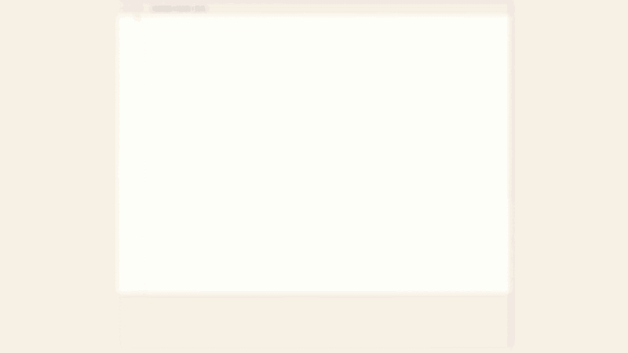
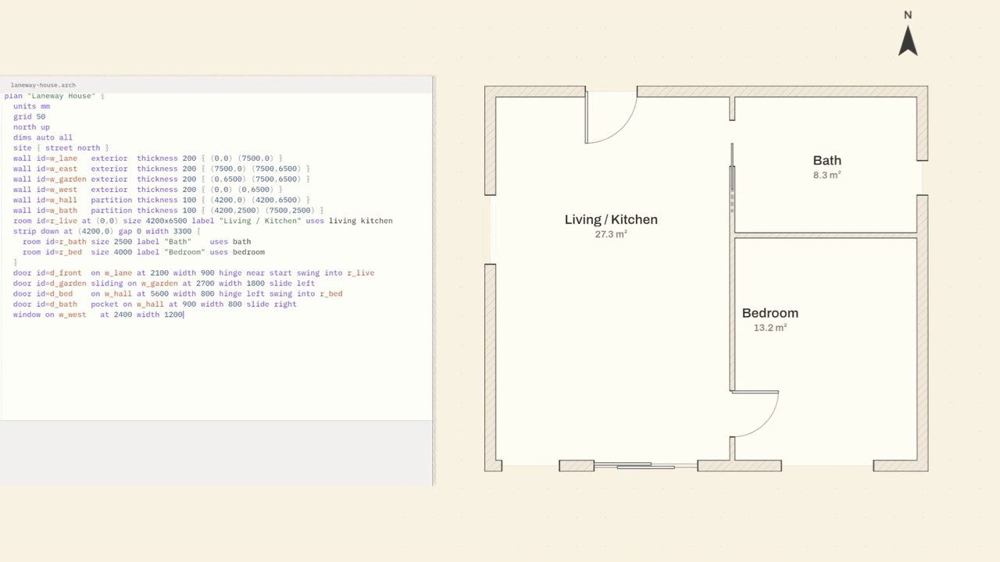
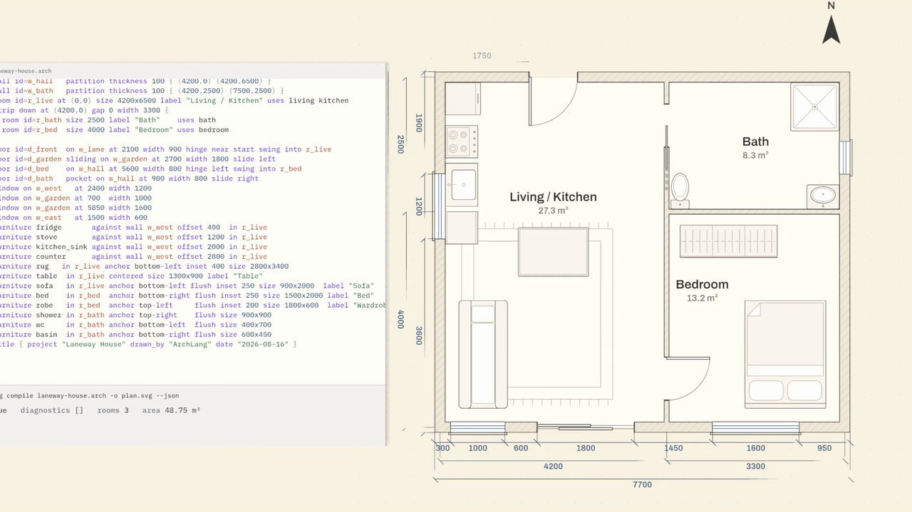
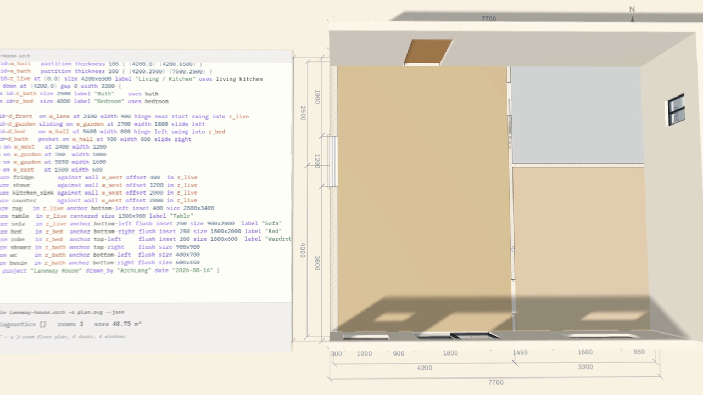
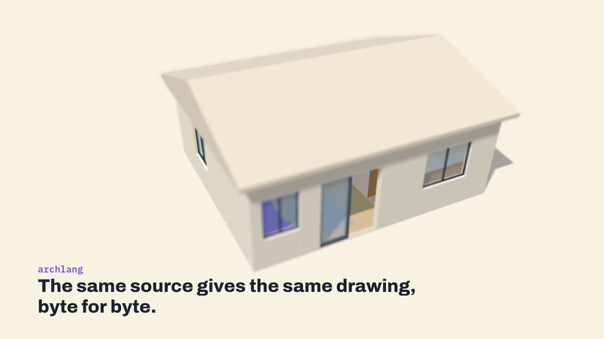
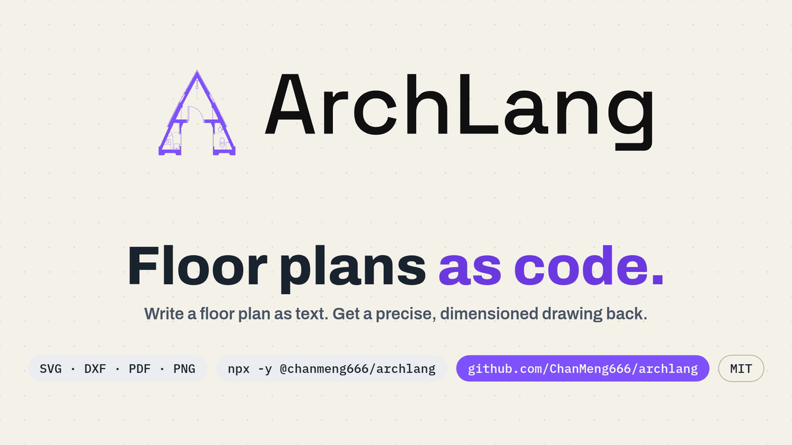
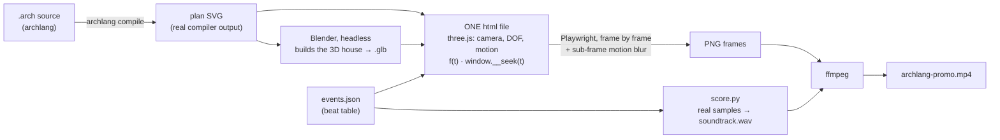

# archlang-promo-threejs

**A 32-second, one-take promo film for [archlang](https://github.com/ChanMeng666/archlang) — a language that lets AI write floor plans as code.** Lines of code become plan lines, the plan grows into a small 3D house, the house folds back into the plan, and the take ends on the logo. Rendered from a single three.js html file, scored with real instrument samples, all of it reproducible from this repository.

<p align="center">
  <a href="https://github.com/ChanMeng666/archlang-promo-threejs/releases/latest"></a>
</p>

<p align="center">
  <a href="https://github.com/ChanMeng666/archlang-promo-threejs/releases/latest"><b>▶ Watch the film (Release assets)</b></a> ·
  <a href="https://github.com/ChanMeng666/archlang">archlang</a> ·
  <a href="CREDITS.md">Credits &amp; licences</a>
</p>

| | |
|---|---|
| Length / format | 32.0 s · 1920×1080 · 30 fps · H.264 + AAC (stereo, 48 kHz) |
| Tempo | **120 BPM**, 4/4 — one beat is 0.5 s, i.e. exactly 15 frames; 16 bars |
| Picture | one three.js scene, no cuts; camera, depth of field and every animation are a pure function of time |
| Sound | sample-based score: drum kit, piano, cello, upright bass, glockenspiel, vibraphone, claves, snaps — all CC0 / public domain |
| Loudness | −16.2 LUFS integrated, loudness range 10.8 LU, peak −1.5 dBFS, 0 samples near full scale (ffmpeg `ebur128` / `volumedetect` on the mp4; sample count on the wav) |

## Stills

| | |
|---|---|
|  |  |
|  |  |
|  | |

## How it was made



1. **archlang code → plan.** The code typed on screen is the real source of archlang's `laneway-house` example ([`data/laneway-house.arch`](data/laneway-house.arch)). It is compiled with the real `archlang compile`; the SVG ([`data/laneway-house.svg`](data/laneway-house.svg)) is drawn on screen element by element.
2. **Blender builds the 3D house.** [`blender/build_house.py`](blender/build_house.py) runs headless (Blender 5.2.3), reads the geometry from the plan (walls, openings, furniture footprints), authors the heights, and exports one object per piece to [`blender/laneway_house.glb`](blender/laneway_house.glb). Blender does nothing else — no camera, no animation.
3. **One html file does the film.** [`src/comp.js`](src/comp.js) loads the glb (inlined as base64 together with three.js, fonts and the SVG) and renders the whole take: camera path, depth-of-field rack focus (`BokehPass`), spring-driven motion and all beat-synced events. State is a pure function of time — `window.__seek(t)` — so any frame can be rendered in any order. Seeds are fixed.
4. **A beat table first, picture and sound second.** The tempo (120 BPM) and the event list (`data/events.json`, dumped from the html) are fixed first; both the animation and the score are generated from that one table.
5. **Frame by frame with motion blur.** [`scripts/render.py`](scripts/render.py) drives headless Chromium (software WebGL / SwiftShader, no GPU) through Playwright. A real shutter is simulated inside the page: for each frame `n` sub-frames across a 180° shutter are averaged (n is chosen from how far things travel; still frames render once). ffmpeg encodes H.264 and muxes the soundtrack.
6. **Score from real instruments.** [`audio/score.py`](audio/score.py) places recorded samples on the beat grid: Big Rusty Drums, Splendid Grand Piano, Karoryfer × bigcat Cello, Karoryfer Meatbass, VCSL (glockenspiel, vibraphone, claves) and body_percussion — all CC0 / public domain ([credits](CREDITS.md)). The mix has velocity layers, multi-mic drums, sidechain ducking from the kick, convolution reverb, loudness normalisation and a look-ahead limiter. Fixed seed: the same samples give a byte-identical `soundtrack.wav`.

### The film in five acts

| time | what happens |
|---|---|
| 0 – 4 s | the archlang code types itself; grid and north arrow appear |
| 4 – 12 s | drums enter; walls, rooms, doors, windows and furniture are drawn on the beat while the code scrolls |
| 12 – 14 s | breath — title block, the compile result and dimensions, a tom roll into the downbeat |
| 14 – 24 s | the plan lifts into a 3D house, camera slides inside, lifts out; the roof lands on the beat; aerial hold |
| 24 – 32 s | the house folds back into the plan, the logo draws, slogan words land, format chips: `SVG · DXF · PDF · PNG`, `npx -y @chanmeng666/archlang`, GitHub, MIT |

### Tempo and drum timetable

Tempo: **120 BPM**, 4/4. 1 beat = 0.5 s = 15 frames at 30 fps. Groove summary (every hit is listed in [`docs/drum_timetable.md`](docs/drum_timetable.md)):

| section | drums |
|---|---|
| 0 – 4 s | no drums — piano, cello, bells and soft typing ticks |
| 4 – 12 s | kick on beats 1 and 3 of each bar (4, 5, 6 … 11 s), snare on 2 and 4 (4.5, 5.5 … 11.5 s), closed hat every eighth note; tom fill 11.5 – 12 s |
| 12 – 14 s | breath: no kick or snare; tom roll in sixteenths 13.0 – 13.875 s; **crash + kick on the downbeat at 14 s** |
| 14 – 22 s | same backbeat with kick pickups (15.75, 17.75, 19.75, 21.75 s) and open hats on those pickups; tom fill 21.5 – 22 s |
| 22 – 24 s | hold: a single kick as the roof lands (23 s); crash at 24 s as the roof lifts off |
| 24 – 28 s | build: kick and hat on eighth notes, snare at 25 s and 27 s, tom roll in sixteenths 26 – 28 s |
| 28 – 32 s | **crash + kick at 28 s (logo)**, kick at 29 and 30 s, snare at 28.5 and 29.5 s, hats until 29.75 s |

### Beat → animation events

Generated by [`scripts/mkreadme_tables.py`](scripts/mkreadme_tables.py) from [`data/events.json`](data/events.json) (full version: [`docs/beat_to_animation.md`](docs/beat_to_animation.md)). `bar : beat` counts 4-beat bars from 1 : 1 at t = 0.

| bar : beat | time (s) | event | what moves / what you hear |
|---|---|---|---|
| 1 : 1 | 0 | intro | editor appears, caret starts |
| 1 : 3.4 | 1.2 … 12.5 | type ×40 | a source line lands (its last character on this beat) |
| 2 : 1 | 2 | grid | plan grid draws in; glockenspiel triad |
| 2 : 1.8 | 2.4 | north | north arrow |
| 3 : 1 | 4 … 6.5 | wall ×6 | plan wall strokes grow (one per hit) |
| 4 : 3 | 7 … 7.5 | room ×3 | room fills + labels |
| 5 : 1 | 8 … 8.75 | door ×4 | door arcs open (finger snaps) |
| 5 : 3 | 9 … 9.75 | window ×4 | window glazing lines (ride bell) |
| 6 : 1 | 10 … 11.75 | furn2d ×12 | furniture symbols pop in (vibraphone) |
| 7 : 1 | 12 | title | title block fades in on the plan (start of the breath before the lift) |
| 7 : 2 | 12.5 | result | compile result read-out (diagnostics, rooms, area) springs in under the code |
| 7 : 2 | 12.5 | dims | dimension strings run in along the plan (led by a reversed-crash swell) |
| 7 : 3.5 | 13.25 | still | marker for the held beat before the lift |
| 8 : 1 | 14 … 15.25 | rise ×6 | wall rises from the plan line (tom) |
| 8 : 1 | 14 | lift | plan → 3D: crash + kick, floor slab springs up, plan fades as the walls grow |
| 8 : 3 | 15 … 16.75 | furn3d ×12 | 3D furniture drops in (vibraphone/claves) |
| 9 : 1.5 | 16.25 … 19 | door_open ×2 | front / bedroom door swings (open-hat chik) |
| 9 : 3 | 17 | slide | camera slides through the house |
| 11 : 2 | 20.5 | whoosh_up | camera lifts out; reversed-crash whoosh |
| 11 : 4 | 21.5 | roof_start | roof starts to descend |
| 12 : 3 | 23 | roof_land | roof lands: kick + tom + claves, aerial hold |
| 13 : 1 | 24 | roof_off | roof off; crash |
| 13 : 1.5 | 24.25 … 26.375 | collapse ×6 | walls fold back down to the plan (toms) |
| 15 : 1 | 28 | logo | logo mark draws; glockenspiel high C |
| 15 : 1.5 | 28.25 | letters | word-mark letters (vibraphone arpeggio) |
| 15 : 3 | 29 … 29.5 | slogan ×3 | slogan words, one per beat-subdivision |
| 16 : 1 | 30 | sub | sub-line |
| 16 : 2 | 30.5 | chips | format / npx / GitHub / MIT chips |

## Repository layout

```
archlang-promo/
├── README.md  CREDITS.md  LICENSE
├── package.json  package-lock.json    # three.js, esbuild, fonts (build-time only)
├── requirements.txt                   # numpy scipy soundfile pyloudnorm playwright
├── src/
│   ├── comp.js                        # the composition: beat table, editor / plan / HUD drawing, camera, DOF, events, shutter
│   ├── template.html                  # html shell + player UI (play / scrub)
│   └── entry.js                       # three.js + post-processing bundle entry (esbuild)
├── blender/
│   ├── build_house.py                 # headless Blender → laneway_house.glb (+ two Cycles preview PNGs)
│   ├── laneway_house.glb  preview_cutaway.png  preview_roof.png
├── audio/
│   ├── samplers.py                    # sample loading, pitch-resampling, velocity layers, multi-mic drums
│   ├── score.py                       # the score + mix → dist/soundtrack.wav
│   └── mix_log.json                   # every note / hit the score placed (time, stem, name)
├── data/
│   ├── events.json                    # the beat table + 115 animation events (read by html, score, checks)
│   ├── laneway-house.arch  laneway-house.svg   # real archlang source and its compiled SVG
│   └── archlang-wordmark-black.svg    # archlang brand-kit word-mark (logo on the end card)
├── scripts/
│   ├── build.py                       # assemble dist/archlang-promo.html (single file)
│   ├── render.py                      # frame-by-frame render + shutter + ffmpeg mux
│   ├── dump_events.py                 # html → data/events.json
│   ├── verify_sync.py                 # do the events land on sound? (numbers below)
│   ├── still.py                       # un-blurred stills from the html at given times
│   ├── mkreadme_tables.py             # events.json + mix_log.json → docs/*.md tables
│   ├── fetch_samples.sh               # sample libraries, pinned commits, only the files used
│   ├── make_docs.sh                   # preview GIF + stills from the mp4
│   ├── make_release_assets.sh         # AAC encode, html with audio, SHA256SUMS
│   └── common.py                      # paths and browser launch
└── docs/  preview.gif  stills/  drum_timetable.md  beat_to_animation.md  verify_sync.txt
```

Not in git (built or fetched locally): `dist/`, `build/`, `node_modules/`, `samples/`, `release_assets/`. The finished film, soundtrack and the single-file html are attached to the [Release](https://github.com/ChanMeng666/archlang-promo-threejs/releases/latest).

## Reproduce

Requirements (the versions the film was built and tested with): Python 3.13, Node 20, `ffmpeg`, `git`, Google Chrome (or Playwright's Chromium, see below). Blender 5.x is only needed to rebuild the glb (a built copy is committed). No GPU is needed.

```bash
git clone https://github.com/ChanMeng666/archlang-promo-threejs.git && cd archlang-promo-threejs

# 0. dependencies
python3 -m venv venv && . venv/bin/activate        # Windows: venv\Scripts\activate
pip install -r requirements.txt
npm install                                        # three.js, esbuild, fonts
# browser: the scripts use the installed Chrome. To use Playwright's Chromium instead:
#   playwright install chromium && export ARCHLANG_PROMO_CHANNEL=chromium

# 1. (optional) rebuild the inputs
npx -y @chanmeng666/archlang compile data/laneway-house.arch -o data/laneway-house.svg
blender -b --factory-startup --python-exit-code 1 -P blender/build_house.py -- blender      # Blender 5.x

# 2. build the single html (without audio first), dump the event table
python scripts/build.py --noaudio                  # → dist/archlang-promo.html
python scripts/dump_events.py                      # → data/events.json (already committed; identical)

# 3. the score: fetch the sample libraries (≈ 0.7 GB, pinned commits), then mix
bash scripts/fetch_samples.sh                      # → samples/
python audio/score.py                              # → dist/soundtrack.wav (24-bit, 48 kHz, ~7 s)

# 4. check that picture events land on sound
python scripts/verify_sync.py

# 5. render: a 5-frame smoke test, then the whole film
python scripts/render.py --frames 0:5 --workers 2
python scripts/render.py --workers 3 --audio dist/soundtrack.wav     # → dist/archlang-promo.mp4

# 6. single-file html with the audio embedded + release folder
bash scripts/make_release_assets.sh
```

Notes
* **Render time.** Software WebGL is slow: one full pass over the 960 frames took about 36 minutes with 3 workers on an 8-core, 16 GB box. Use `--w 1280 --h 720` for a quick draft and `--workers` ≤ 3 if memory is tight. A render can be resumed with `--resume --keep`.
* **Look at a frame without rendering the film:** `python scripts/still.py 23.5,31.8 --w 1920 --h 1080`, or open `dist/archlang-promo.html` in a browser and press play (scrub bar included).
* **Change the beat table:** edit `K` in `src/comp.js`, rebuild, `dump_events.py`, re-run `score.py` — the sound follows the picture.
* The Blender step is deterministic: re-running it reproduces the committed glb byte for byte.

## Does the animation land on the sound? (honest numbers)

`scripts/verify_sync.py` ([output](docs/verify_sync.txt)) checks the 113 timed animation events (the 115 in `events.json` minus the `intro` and `still` markers):

* **Score vs. events: 113 / 113** events have a sound scheduled at exactly their time (max deviation 0.0 ms). Picture and score read the same `events.json`; the mp4's audio was cross-correlated against `soundtrack.wav` around the 14 s downbeat: lag 0 samples (also at 3.9 s and 27.9 s).
* **Independent onset detection** on the rendered `soundtrack.wav` (high-passed log-energy flux, 194 onsets found): **72 / 113** events have a detected onset within one frame (33 ms); 69 / 113 within 15 ms; median distance 2.5 ms. The remaining events are mostly the soft typing ticks and quiet vibraphone/glockenspiel notes under the drums, which a simple detector does not pick out — they are scheduled, but not all of them are clearly audible.
* **On the beat grid:** 91 / 113 events sit on the 0.25 s (eighth-note) grid; **86 / 113** coincide with a drum hit at exactly that time and 101 / 113 are within 0.25 s of one. The 12 events more than 0.25 s from any drum hit are: six typed code lines plus the grid and the north arrow in the first 4 s (no drums yet), three at 12.5 s (the typed compile command, the result read-out and the dimensions, in the drum-less breath) and the closing chips at 30.5 s.
* A cruder attack-contrast measure (> 800 Hz energy after vs. before the event) shows ≥ +3 dB at 38 / 113 events and ≥ +1 dB at 67 / 113; the slow swells (`slide`, `sub`) are the weakest by design.

## Honest notes

* **archlang draws 2D.** The compiler outputs floor-plan drawings (SVG, DXF, PDF, PNG). The 3D house in this film is an artistic extension built in Blender from the plan's geometry (the heights are authored in the Blender script because a plan carries none). It is **not** an archlang feature.
* The source lines typed in the editor are real lines of archlang's `laneway-house` example (comments and blank lines left out), and the plan is the compiler's actual SVG for it (`npx -y @chanmeng666/archlang compile` reproduces it byte for byte).
* No instrument in the score is synthesised. Two things are processing rather than recordings: the reverb impulse response is shaped noise (used only to convolve the recorded sounds), and the two rising "whoosh" swells are time-reversed recordings of a real crash cymbal.
* The *Terkelsen Marimba* library was evaluated and **not used** (licence not clear enough for redistribution).
* Rendering uses software WebGL, so pixels can differ slightly between machines/browsers. On the build machine, 4 of the 5 frames re-rendered from this repository (frames 0, 3, 4, 705) matched the released frames bit for bit; the 5th (frame 706) differed in 117 of 2 073 600 pixels (max 39 / 255). The soundtrack is byte-identical when rebuilt from freshly fetched samples (SHA-256 in `release_assets/SHA256SUMS.txt` of the release).
* onetake's `probe.py` motion probe was run on the html but cannot see inside WebGL/canvas drawing (it reported no tracked motion), so the one-take continuity was judged by eye on extracted frames rather than by that tool.
* Beyond the file-level checks above, nobody has listened to the final mix on studio monitors: levels were set from stem measurements and loudness meters.

## Credits &amp; licences

Full details, sources and pinned commits: **[CREDITS.md](CREDITS.md)**.

| Item | Licence |
|---|---|
| Big Rusty Drums (Karoryfer Samplecraft), Karoryfer × bigcat Cello, Karoryfer Meatbass, VCSL (Versilian Community Sample Library), body_percussion | CC0 1.0 |
| Splendid Grand Piano (Akai) | public domain |
| three.js | MIT |
| Blender (used to build the glb) | GPL |
| Archivo, IBM Plex Mono (via Fontsource) | SIL OFL 1.1 |
| archlang (language, example, brand kit) | MIT |
| [onetake](https://github.com/feitangyuan/onetake) | PolyForm Noncommercial 1.0.0 — only its *method* (one continuous take, `f(t)` composition, shutter blur, events → score) was followed; none of its code or assets is copied here |
| **This repository's code** | **MIT** — see [LICENSE](LICENSE) |
